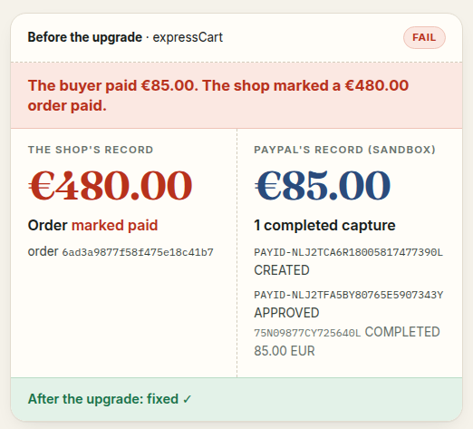

# Checkout Proof

**An AI agent upgrades PayPal checkouts, then proves the upgrade in the PayPal sandbox.**

Live demo: https://checkout-proof-149219545146.us-central1.run.app · PayPal AI Hackathon entry, 2026.



Popular open-source shops still run PayPal's deprecated server SDKs (`paypal-rest-sdk`, `@paypal/checkout-server-sdk`),
and 222 popular repos load JS SDK v5 while none we found loads v6. Migration guides and PayPal's own AI tools tell you
what to change. None of them runs your checkout to show that the new one still takes money correctly.

Checkout Proof does three things:

1. **Scan.** Static rules find JS SDK v5 (fully supported by PayPal; v6 is the newer SDK), the pieces PayPal has
   deprecated, and money-losing patterns, with file and line. Try it on any public repo in the demo's scan box.
2. **Upgrade.** Claude moves the shop to JS SDK v6 and `@paypal/paypal-server-sdk`, guided by PayPal's AI Toolkit
   and the APIMatic context plugin. It never sees credentials.
3. **Prove and repair.** The shop's own server runs against the PayPal sandbox: a real sandbox buyer,
   `PayPal-Mock-Response` declines and errors, lost responses, tampered orders, two tabs. Money rules compare the
   shop's record with PayPal's (`GET /v2/checkout/orders/{id}`). Failures go back to the agent with the evidence
   until every scenario passes.

<!-- generated:ai-catch -->
**The proof caught a real double charge, and Claude fixed it from the evidence alone.** On simple-clothing-store, after a hand edit (e47e7bd), the next proof found that the shop charged the buyer twice for one order from two tabs (0TG628623J5721737, 3N277234VH1857443). The proof sent that evidence back to Claude: fix round 1, 27 turns, 246 s, commit 90473e7. The next proof passed 28 of 28.
<!-- /generated:ai-catch -->

<!-- generated:plain-arm -->
**The plain-prompt test.** Each shop was upgraded twice: once from a plain upgrade request with no money rule, once with our money rules in the prompt. On expressCart both upgrades passed all 13 sandbox runs at their first proof (17 Oct). Scenarios added on 19 Oct were never fed back to the plain upgrade, and its final code fails both (2 of 15 sandbox runs on the larger suite): it marked a €73.00 order paid for 73.00 MXN; and marked a €73.00 order paid for €1.00 (both PayPal answers simulated). On simple-clothing-store the plain upgrade failed 6 of 22 sandbox runs at its first proof (17 Oct): it marked a €62.00 order paid for 62.00 MXN from a PayPal order that was not its own; marked a €62.00 order paid for €1.00 from a PayPal order that was not its own; and charged the buyer twice for one order from two tabs. The failing evidence went back to the model with no rules added. After one fix round (14 turns, 85 s): 21 pass, 1 inconclusive (sandbox timeout), 0 fail. Scenarios added on 19 Oct were never fed back to the plain upgrade, and its final code fails 4 of the 6, in each of its 2 modes (8 of 34 sandbox runs on the larger suite): it answered a capture PayPal refused with PAYER_ACTION_REQUIRED as if it had worked; confirmed an order whose capture PayPal refused (TRANSACTION_REFUSED); lost an approved payment when the shop restarted before the capture; and forgot a payment in progress when the shop restarted, and let the buyer pay again. Only the sandbox proof could tell the cases apart.
<!-- /generated:plain-arm -->

Who does what: Claude writes the upgrade and the fix rounds (any hand edit is labelled as one on the evidence
page); deterministic code does the scan, drives the sandbox
buyer, scripts the failures and decides every verdict. No model judges its own work.

## Results on two real open-source shops

The numbers in this section and the two paragraphs above are generated from the site's data by
`npm run export-web`; `tests/readme-numbers.test.ts` fails when they drift.

<!-- generated:results -->
2 shops, 9 money bugs found in the sandbox (16 failing runs before the upgrade); none fails after it.

| Shop | Before the upgrade | After |
|---|---|---|
| [expressCart](https://github.com/mrvautin/expressCart) (about 2.2k ★) | 4 money bugs (4 failing runs), for example: The buyer paid €85.00. The shop marked the €480.00 order Paid, with all 8 items in it. | 15 of 15 pass |
| [simple-clothing-store](https://github.com/kerkkoh/simple-clothing-store) | 5 money bugs (12 failing runs), for example: The buyer never approved anything. The shop confirmed the €62.00 order anyway. | 35 of 35 pass (1 not applicable) |
<!-- /generated:results -->

Every verdict on the demo comes with PayPal's own record of the sandbox order: order and capture IDs wherever an order
exists, and PayPal's debug IDs wherever PayPal answered. You can re-run the upgraded simple-clothing-store's proof live from the demo, with fresh sandbox orders, and
watch the original shop lose money in two short scenarios (that run is expected to come back red). Through judging, the live
runs are open to the hackathon's judges (a code in the submission's testing instructions); every saved run is public.
Neither needs a login: the runs use our own sandbox buyer. Everything runs in the PayPal sandbox; no real money moves.

What is covered, and what is not:
- `PAYER_ACTION_REQUIRED` runs as a **mocked** refusal on capture (`PayPal-Mock-Response`): the shop must send the
  buyer to the order's `payer-action` link and a later capture must succeed. A real 3-D Secure challenge is not run;
  it lives in card fields.
- Not covered yet: card fields and card declines (JS SDK v6 card fields), refunds through the shop (neither
  original shop issues refunds; the harness refunds its own test captures), and authorize-then-capture.
- Each shop needs a hand-written adapter for the proof (how to start it, read an order, drive its checkout).
- [`SCENARIOS.md`](SCENARIOS.md) lists the scenarios that run today, per shop.

## Run it locally

Needs Node 22+, a `.env` with sandbox credentials (names in `.env.example`; sandbox only), the target clones in
`out/targets/` and the APIMatic plugin clone in `out/vendor/` (see `APIMATIC-NOTES.md`).

```
npm install --ignore-scripts && npx playwright install chromium
npm test                                                   # money rules, scan rules, scrub (vitest)
npm run cp -- scan out/targets/simple-clothing-store       # static: JS SDK v5, deprecated SDKs, risky patterns
npm run cp -- prove simple-clothing-store --variant original --mode demo|production
npm run cp -- upgrade simple-clothing-store [--fresh] [--plain]   # claude -p edits a work copy
npm run cp -- loop simple-clothing-store --max 3           # prove the upgrade, feed failures back, re-prove
npm run cp -- pack simple-clothing-store                   # out/evidence/<target>/PR-BODY.md, EVIDENCE.md
npm run export-web && (cd web && npm run build) && npm run server   # the demo site on http://127.0.0.1:8790
```

expressCart takes the same commands (`prove expressCart --variant original|upgraded`, no `--mode`). It needs a local
MongoDB: `scripts/mongod.sh fetch && scripts/mongod.sh start` (no Docker). `CP_ARM=plain` keeps a second upgraded
copy for the plain upgrade request (no money rule).

## Fallback site (read-only copy)

If the live demo is down (its billing cap switches it off), a static copy of the evidence pages can stand in. It has
the same pages and data; the live buttons and the scan box say "live demo at <URL>" instead, and the saved live runs
come from a snapshot of the live site taken at build time.

```
bash scripts/build-static.sh [--base /checkout-proof/]   # → out/static-site/ (GitHub Pages project path)
```

To publish on GitHub Pages from this repo: push `out/static-site/` to a `gh-pages` branch
(`git subtree push --prefix` does not work on a gitignored folder, so copy it into a fresh worktree of that branch,
commit and push), then Settings → Pages → "Deploy from a branch", `gh-pages`, `/ (root)`. The site is then at
`https://<owner>.github.io/<repo>/`; `--base` must be `/<repo>/`. Every route has its own `index.html` and a
`404.html`, since Pages has no rewrites.

- [`DESIGN.md`](DESIGN.md): how it is built.
- [`SCENARIOS.md`](SCENARIOS.md): the scenarios, with mock codes checked against PayPal's docs.
- [`TARGETS.md`](TARGETS.md): the candidate shops and their defects.
- [`APIMATIC-NOTES.md`](APIMATIC-NOTES.md): what the APIMatic context plugin got right and wrong.
- `out/` (gitignored): target clones (untrusted, only read), PayPal docs fetched on 16 Oct 2026, run artefacts.
